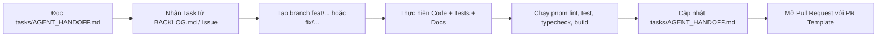

# AGENTS.md - Campus Marketplace Monorepo Guidelines

> **LƯU Ý QUAN TRỌNG:** Tệp `AGENTS.md` này không tự động giao tiếp giữa các AI Agent. Mọi AI Agent (và kỹ sư phần mềm) **BẮT BUỘC** sử dụng **GitHub Issues**, **Pull Requests** và tệp **`tasks/AGENT_HANDOFF.md`** làm kênh ghi nhận trạng thái, tiếp nhận nhiệm vụ và bàn giao kết quả. Mỗi Agent trước khi bắt đầu phiên làm việc phải đọc trạng thái mới nhất từ `tasks/AGENT_HANDOFF.md`.

---

## 1. Tổng quan dự án

**Campus Marketplace** là nền tảng thương mại điện tử sinh viên nội bộ trường đại học, phục vụ việc mua bán, trao đổi đồ dùng cũ và đăng tin tìm mua đồ dùng học tập/sinh hoạt phòng trọ.

- **Đối tượng:** Sinh viên các trường đại học (xác thực qua email trường và minh chứng thẻ sinh viên).
- **Mục tiêu kiến trúc:** Hệ thống tin cậy, an toàn, giao dịch minh bạch, bảo vệ quyền riêng tư và số điện thoại, tích hợp cơ chế tích luỹ điểm uy tín và báo cáo vi phạm.
- **Source of Truth:**
  - Nghiệp vụ: Hồ sơ Campus Marketplace v1.2 (`D:\Documents\PTIT DOC\SPM\Ho_so_nghiep_vu_Campus_Marketplace_v1.2.docx`).
  - Database: 18 bảng CSDL PostgreSQL v1.2 (`database/baseline/schema_v1.2.sql`).
  - API: OpenAPI Contract 3.x v1.2 gồm 49 endpoints (`packages/api-contract/openapi.yaml`) đồng bộ với Apidog.

---

## 2. Technology Stack

- **Monorepo Manager:** `pnpm workspace` (Node.js 20.20.1, pnpm 10.14.0)
- **Frontend (`apps/frontend`):** React 18, Vite 5, TypeScript, Vitest, React Testing Library.
- **Backend (`apps/backend`):** NestJS 10, TypeScript, `pg` (Node-postgres pool, SQL-first), Jest, Supertest.
- **Database:** PostgreSQL trên Supabase (Database `postgres`, Schema `public`).
- **Hợp đồng API:** OpenAPI 3.x (`@campus/api-contract`), công cụ thiết kế & mock API: Apidog.
- **Code Quality:** ESLint, Prettier, TypeScript Strict Mode.
- **CI/CD:** GitHub Actions (`.github/workflows/ci.yml`).

---

## 3. Kiến trúc Monorepo & Phân vùng trách nhiệm (Code Ownership)

```text
campus-marketplace/
├── apps/
│   ├── frontend/         # @campus/frontend - Ứng dụng Web Client React 18 + Vite 5 (SPA)
│   └── backend/          # @campus/backend - Ứng dụng Modular Monolith API NestJS
├── packages/
│   └── api-contract/     # @campus/api-contract - OpenAPI 3.x spec & definitions
├── database/             # Baseline DDL, Migrations, Seeds, Schema docs
├── docs/                 # Kiến trúc, ADRs, Business Rules, API docs
└── tasks/                # Backlog, Handoff Journal, Task Templates
```

### Quy định quyền sở hữu (Code Ownership):

1. **Frontend Team / Frontend Agent:** Toàn quyền trong `apps/frontend/`. Chỉ đọc `packages/api-contract/`. Không được can thiệp vào `apps/backend/` hay `database/`.
2. **Backend Team / Backend Agent:** Toàn quyền trong `apps/backend/` và quản lý migration trong `database/migrations/`. Backend Lead có trách nhiệm review và tích hợp toàn bộ backend.
3. **Database Agent:** Quản lý `database/`. Tuyệt đối không thay đổi schema trực tiếp mà không qua migration và PR.
4. **Tech Lead / Architect:** Phê duyệt thay đổi trong `packages/api-contract/`, `.github/`, root configurations.

---

## 4. Quy tắc Git & Phối hợp nhóm (Gitflow Workflow)

Dự án áp dụng mô hình **Gitflow** tiêu chuẩn để phân tách rõ ràng giữa mã nguồn ổn định sẵn sàng phát hành và mã nguồn đang phát triển tích hợp:

- **Hai nhánh vĩnh viễn (Permanent Branches):**
  - `main`: Nhánh sản phẩm chính thức (Production). Chỉ chứa các phiên bản phát hành đã được kiểm thử toàn diện, luôn gắn tag phiên bản (ví dụ: `v1.0.0`). Mọi thay đổi vào `main` phải thông qua Pull Request từ `release/*` hoặc `hotfix/*`.
  - `develop`: Nhánh tích hợp phát triển (Active Integration). Là nhánh mặc định cho toàn bộ hoạt động phát triển tính năng. Mọi PR tính năng mới đều hướng về `develop`.
- **Các nhánh hỗ trợ (Supporting Branches):**
  - `feat/fe-<tên-tính-năng>`: Tính năng Frontend rẽ nhánh từ `develop` và merge về `develop`.
  - `feat/be-<tên-tính-năng>`: Tính năng Backend rẽ nhánh từ `develop` và merge về `develop`.
  - `fix/<mô-tả-lỗi>`: Sửa lỗi phát sinh trong quá trình dev, rẽ nhánh từ `develop`.
  - `release/vX.Y.Z`: Chuẩn bị phát hành, rẽ nhánh từ `develop`, sau khi ổn định sẽ merge vào cả `main` và `develop`.
  - `hotfix/<mô-tả-lỗi>`: Vá lỗi khẩn cấp trên production, rẽ nhánh trực tiếp từ `main` và sau đó merge về cả `main` và `develop`.
  - `docs/<nội-dung>`, `chore/<công-việc>`: Tài liệu hoặc cấu hình công cụ.
- **Cam kết commit & Pull Request:**
  - Commit message tuân thủ Conventional Commits: `feat:`, `fix:`, `docs:`, `chore:`, `test:`, `refactor:`.
  - Tuyệt đối KHÔNG commit `node_modules`, file build `dist/`, hoặc secret credentials (`.env`).
  - Mọi PR vào `develop` hoặc `main` phải có đầy đủ review và vượt qua CI GitHub Actions.
  - KHÔNG tự ý force-push (`git push --force`) vào `main` hoặc `develop`.

---

## 5. Tiêu chuẩn hoàn thành (Definition of Done - DoD)

Một nhiệm vụ chỉ được coi là hoàn tất khi đáp ứng đầy đủ:

1. **Clean Code & Type Safety:** TypeScript biên dịch không lỗi (`pnpm typecheck`), ESLint không vi phạm (`pnpm lint`).
2. **Automated Tests:** Tất cả unit tests, frontend tests và backend E2E tests đều vượt qua (`pnpm test`, `pnpm test:e2e`).
3. **Build Success:** Tất cả packages và apps đều build thành công (`pnpm build`).
4. **Contract & Envelope Adherence:** Tuân thủ đúng OpenAPI contract đã duyệt: Success Envelope chuẩn `{ success: true, data, timestamp }` và Error Envelope chuẩn OpenAPI v1.2 `ErrorEnvelope` gồm `{ error: { code, message, details }, requestId }` (nghiêm cấm trả trường thừa vì `additionalProperties: false`). Mọi lỗi máy chủ nội bộ (không phải `HttpException`) bắt buộc trả HTTP 500 với thông điệp công khai an toàn, tuyệt đối không tiết lộ `exception.message`, cấu hình database hay stack trace. Frontend `ApiClient` bắt buộc validate envelope nghiêm ngặt (không fallback payload phẳng hay null).
5. **Security & TLS Verification:** Tuyệt đối không tắt kiểm tra chứng chỉ TLS (`rejectUnauthorized: false`) trên kết nối cơ sở dữ liệu remote/Supabase. Không lộ password, API key, token bí mật.
6. **Traceability:** Đã ghi nhận bàn giao vào `tasks/AGENT_HANDOFF.md` và tạo/cập nhật Pull Request theo đúng mẫu `.github/pull_request_template.md`.

---

## 6. Quy trình tiếp nhận và bàn giao nhiệm vụ (Task Lifecycle)



1. **Bước 1 (Nhận việc):** Đọc trạng thái cuối cùng trong `tasks/AGENT_HANDOFF.md` để nắm bối cảnh hệ thống hiện tại.
2. **Bước 2 (Triển khai):** Tạo nhánh mới theo quy ước, chỉ thao tác trong phạm vi được phân công.
3. **Bước 3 (Kiểm chứng):** Chạy toàn bộ test suites cục bộ trước khi commit.
4. **Bước 4 (Bàn giao):** Viết nhật ký bàn giao vào `tasks/AGENT_HANDOFF.md`, chỉ rõ những việc đã làm, các file sửa đổi và hướng dẫn cho người/agent kế tiếp.

---

## 7. Quy tắc bảo mật tối cao (Security Directives)

- **Tuyệt đối không lưu trữ hoặc commit bí mật:** Không push `.env`, Supabase service role key, database password, JWT secret lên repository.
- **Bảo vệ dữ liệu nhạy cảm sinh viên:**
  - Mật khẩu phải được hash bằng bcrypt / argon2 trước khi lưu vào CSDL.
  - Mã OTP chỉ lưu bản băm `code_hash`.
  - Ảnh thẻ sinh viên (`student_evidences.card_image_ref`) là dữ liệu mật. Sau khi upload, ảnh thẻ và chi tiết minh chứng được ẩn hoàn toàn trên giao diện người dùng (kể cả chủ tài khoản sau khi duyệt theo BR-03; `GET /me` không trả `cardImageRef`). CHỈ ADMIN mới có quyền truy cập ảnh thẻ sinh viên qua Signed URL có thời hạn ngắn phục vụ quy trình thẩm duyệt (`GET /api/v1/admin/verifications/{id}`).
  - Số điện thoại người dùng không trả về công khai trong API chi tiết bài đăng; chỉ tiết lộ khi có sự kiện `phone_reveal_events`.

---

## 8. Quy trình khi API Contract thay đổi

1. Nếu một bên (FE hoặc BE) phát hiện cần bổ sung endpoint mới hoặc sửa đổi kiểu dữ liệu:
   - **CẤM** tự ý thêm endpoint vào Backend controller mà chưa có trong OpenAPI spec.
   - **CẤM** Frontend tự bịa trường response hoặc URL API ảo.
2. **Quy trình chuẩn:**
   - Mở thảo luận / Issue mô tả nhu cầu thay đổi.
   - Thống nhất schema với Tech Lead và Lead của bên còn lại.
   - Cập nhật file `packages/api-contract/openapi.yaml` (gắn nhãn `x-source: Proposed extension` nếu đang trong giai đoạn thử nghiệm).
   - Đồng bộ lên dự án Apidog chung.
   - Sau khi contract được phê duyệt, Backend tiến hành code và Frontend tích hợp.
