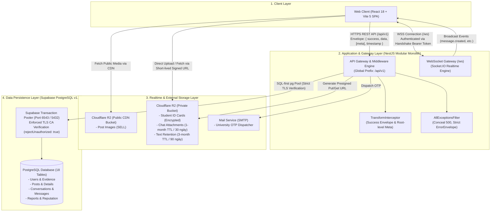
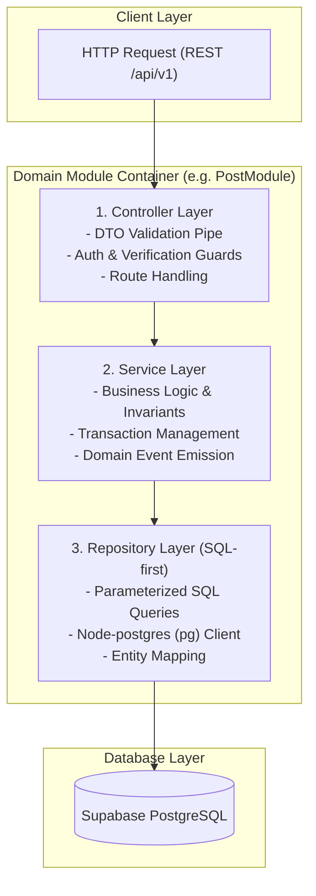
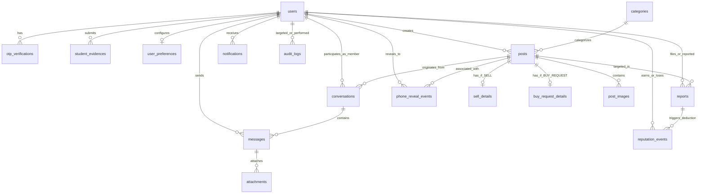
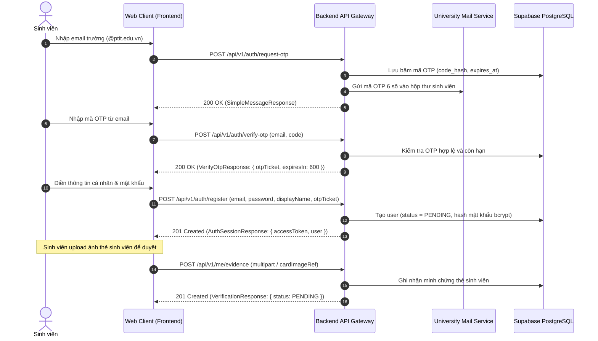
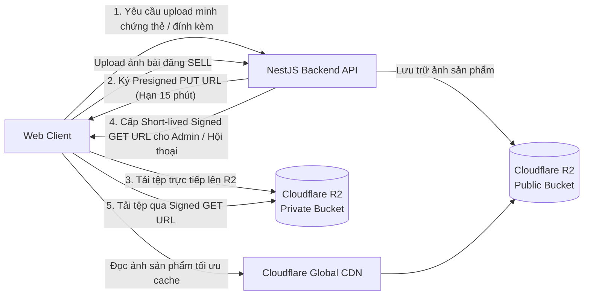
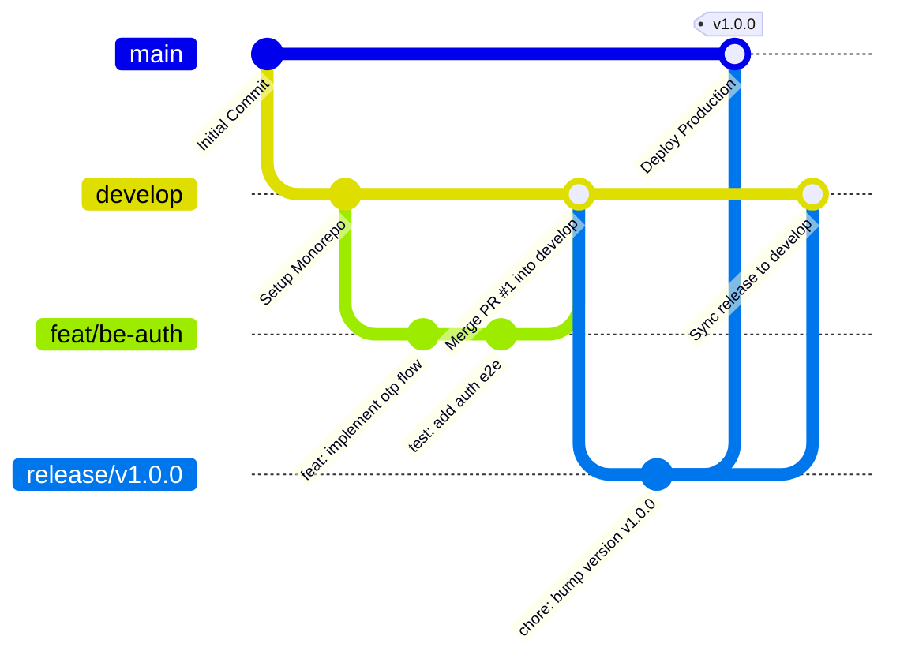
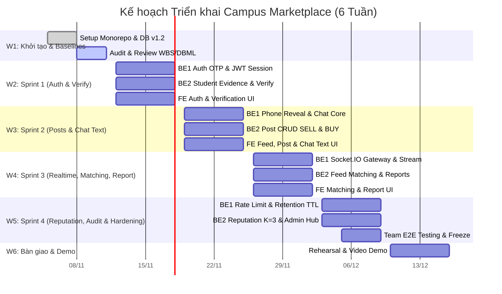

# Campus Marketplace — Kiến trúc Hệ thống & Thiết kế Kỹ thuật (System Architecture & Technical Design)

> **Tài liệu Tham chiếu Kiến trúc Cốt lõi (Core Architecture Documentation)**  
> **Phiên bản:** v1.2 (Đồng bộ Hồ sơ Nghiệp vụ v1.2 & OpenAPI Contract 3.x v1.2)  
> **Dự án:** Campus Marketplace — Nền tảng Thương mại Điện tử Sinh viên Nội bộ  
> **Mã nguồn:** Monorepo (`@campus/frontend`, `@campus/backend`, `@campus/api-contract`)

---

## 1. Overview (Tổng quan Kiến trúc & Công nghệ)

### 1.1. Bối cảnh & Mục tiêu Hệ thống

**Campus Marketplace** là nền tảng thương mại điện tử sinh viên nội bộ trường đại học, phục vụ nhu cầu trao đổi, mua bán đồ dùng cũ (giáo trình, thiết bị học tập, vật dụng phòng trọ) và đăng tin tìm mua (buy requests).

Hệ thống được thiết kế hướng tới 4 mục tiêu kiến trúc trọng yếu:

1. **Tin cậy & Xác thực chặt chẽ:** Chỉ sinh viên sở hữu email trường đại học (`@*.edu.vn`) và đã được Admin phê duyệt minh chứng thẻ sinh viên mới được tham gia giao dịch đầy đủ.
2. **Bảo vệ Quyền riêng tư (Privacy-by-Design):** Che giấu số điện thoại người bán, chỉ cho phép tiết lộ có kiểm soát qua sự kiện ghi nhận; ẩn hoàn toàn ảnh thẻ sinh viên sau khi nộp.
3. **Minh bạch & An toàn Giao dịch:** Tích hợp cơ chế chấm điểm uy tín (`reputation_score`), xử lý tranh chấp khiếu nại (`reports`) và tự động áp dụng chế tài vi phạm.
4. **Vận hành Tinh gọn (Operational Simplicity):** Tối ưu hóa chi phí hạ tầng và độ phức tạp vận hành thông qua kiến trúc **Modular Monolith** và quản lý mã nguồn tập trung bằng **Monorepo**.

### 1.2. Bảng Công nghệ Lựa chọn (Technology Stack)

| Phân vùng              | Công nghệ lựa chọn                 | Phiên bản                                | Vai trò & Lý do lựa chọn                                                                                                |
| :--------------------- | :--------------------------------- | :--------------------------------------- | :---------------------------------------------------------------------------------------------------------------------- |
| **Monorepo Manager**   | `pnpm workspace`                   | 10.14.0 (Node.js 20.20.1)                | Quản lý đa dự án, tối ưu bộ nhớ ổ đĩa qua hard-link store, chia sẻ trực tiếp `@campus/api-contract`.                    |
| **Frontend**           | React 18 + Vite 5 (SPA)            | React 18.3.x, Vite 5.4.x, TypeScript     | Web Client SPA hiện đại, build siêu tốc với Vite 5 (606ms), tối ưu giao diện tương tác và tích hợp Realtime Chat Socket.IO. |
| **Backend**            | NestJS                             | 10.4.x, TypeScript Strict                | Framework hướng module doanh nghiệp, hỗ trợ Dependency Injection, Pipes, Interceptors, Guards đồng bộ.                  |
| **Database Access**    | SQL-first với `node-postgres (pg)` | 8.13.x                                   | Triết lý **SQL-first** (thay thế Prisma ORM), kiểm soát tối đa câu truy vấn, chỉ mục, Explain Plan và hiệu năng pooler. |
| **Database Engine**    | PostgreSQL trên Supabase           | PostgreSQL 15/17                         | CSDL quan hệ chuẩn ACID, hỗ trợ 18 bảng nghiệp vụ v1.2, kết nối bắt buộc xác thực TLS Root CA.                          |
| **Object Storage**     | Cloudflare R2                      | S3-Compatible API                        | Lưu trữ ảnh bài đăng, ảnh thẻ sinh viên mật và tệp đính kèm tin nhắn; hỗ trợ Short-lived Signed URLs.                   |
| **Realtime Engine**    | Socket.IO / WebSocket              | 4.x (`/ws`)                              | Cập nhật tin nhắn tức thì, thông báo hệ thống và tiến trình khiếu nại báo cáo cho người dùng `APPROVED`.                |
| **API Contract**       | OpenAPI 3.x / Apidog               | OpenAPI 3.0.3 v1.2                       | Contract-first: Định nghĩa 49 endpoints, Envelope chuẩn hóa và Schema Validation cho FE/BE.                             |
| **Kiểm thử (Testing)** | Vitest, RTL, Jest, Supertest       | Mới nhất                                 | Unit test, Component test, Backend E2E và Contract Schema regression testing.                                           |
| **CI/CD & Chất lượng** | GitHub Actions, ESLint, Prettier   | TypeScript Strict Mode                   | Tự động hóa kiểm tra Lint, Typecheck, Test và Build trên từng Pull Request.                                             |

---

### 1.3. Xác Nhận Lựa Chọn Công Nghệ Cốt Lõi (Core Technology Stack Confirmation — Quyết định D11)

Dựa trên quyết định chính thức đã xác nhận của nhóm (Decision **D11** trong tệp rà soát kiến trúc), công nghệ cốt lõi của toàn hệ thống được chốt và thống nhất đồng bộ 100%:

| Thành phần cốt lõi  | Ban đầu nhóm chốt (Đề xuất ban đầu) | Technical Architecture hiện tại (ĐÃ CHỐT CHÍNH THỨC) | Lý do & Quyết định kiến trúc (Decision D11 & ADRs)                                                                                                                                                                          |
| :------------------ | :---------------------------------- | :--------------------------------------------------- | :-------------------------------------------------------------------------------------------------------------------------------------------------------------------------------------------------------------------------- |
| **Frontend**        | Next.js                             | **React 18 + Vite 5 (SPA)**                          | **Chốt theo D11:** Tối ưu hóa tính gọn nhẹ của ứng dụng SPA sinh viên, build siêu tốc bằng Vite 5/esbuild (606ms), loại bỏ độ phức tạp SSR server runtime khi duy trì kết nối WebSocket Socket.IO `/ws` và API Envelope NestJS.    |
| **Database Access** | Prisma                              | **SQL-first với `node-postgres (pg)`**               | **Chốt theo D11:** Kiểm soát 100% câu truy vấn SQL thô, tối ưu Explain Plan và chỉ mục trên 18 bảng CSDL v1.2, loại bỏ overhead binary engine của Prisma và tương thích hoàn hảo với PgBouncer Transaction Pooler.         |
| **Database**        | PostgreSQL                          | **PostgreSQL trên Supabase**                         | Hệ quản trị cơ sở dữ liệu quan hệ chuẩn ACID, lưu trữ toàn vẹn 18 bảng nghiệp vụ v1.2, vận hành trên Supabase Cloud với PgBouncer Pooler và thực thi bắt buộc xác thực TLS CA certificate (`rejectUnauthorized: true`).   |
| **Backend**         | NestJS                              | **NestJS 10**                                        | Giữ nguyên kiến trúc Modular Monolith NestJS 10, quản lý Dependency Injection, Interceptors, Pipes, Filters và Guards tập trung.                                                                                           |

> [!IMPORTANT]
> **Xác nhận Kiến trúc Cốt lõi (React 18 + Vite 5 & PostgreSQL trên Supabase):**
>
> 1. **React 18 + Vite 5 là Web Client chính thức (D11):** Web Client vận hành dưới dạng Single Page Application (SPA) với React 18, Vite 5, TypeScript và Vitest. Toàn bộ routing do client đảm nhiệm (`react-router-dom`), phân định rõ trang xem tin giới hạn (`PendingFeedPage` cho PENDING) và trang đầy đủ (`PostPage` cho APPROVED). Không sử dụng Next.js.
> 2. **PostgreSQL là CSDL quan hệ chuẩn:** Toàn bộ 18 bảng nghiệp vụ v1.2 (người dùng, bài đăng, hội thoại, báo cáo khiếu nại, điểm uy tín) được thiết kế và vận hành trên **PostgreSQL 15/17 trên Supabase** với PgBouncer Pooler và kết nối TLS bắt buộc (`rejectUnauthorized: true`).

---

## 2. System Architecture (Sơ đồ Kiến trúc Toàn hệ thống)

Hệ thống kết nối chặt chẽ giữa Web Client, Backend API Gateway, Cơ sở dữ liệu quan hệ PostgreSQL và Cloudflare R2 Object Storage:



### Luồng Xử lý Dữ liệu Chính (Data Flow):

1. **Xác thực & Ủy quyền:** Request gửi tới mang theo JWT Bearer Token trong header `Authorization`. `JwtAuthGuard` giải mã token, `VerificationGuard` và `RolesGuard` thẩm định quyền truy cập dựa trên trạng thái (`APPROVED`, `PENDING`, `ADMIN`).
2. **Bọc gói Phản hồi Thành công (Success Envelope):** `TransformInterceptor` bọc dữ liệu trả về từ Controller:
   - Dữ liệu đơn lẻ: `{ success: true, data: T, timestamp: ISO8601 }`.
   - Dữ liệu phân trang: `{ success: true, data: T[], meta: PageMeta, timestamp: ISO8601 }` (Root-level `data` và `meta`, tuyệt đối không lồng `data: { data, meta }`).
3. **Chuẩn hóa Phản hồi Lỗi (Error Envelope):** Khi có ngoại lệ, `AllExceptionsFilter` bắt toàn bộ và trả về `{ error: { code, message, details? }, requestId? }` tuân thủ nghiêm ngặt ràng buộc `additionalProperties: false`. Mọi lỗi 500 đều được giấu kín thông tin nhạy cảm và trả về thông điệp an toàn `"Internal server error"`.

---

## 3. Monorepo Structure (Cấu trúc Thư mục Dự án)

Dự án áp dụng mô hình **pnpm monorepo workspace** nhằm thống nhất quản lý phụ thuộc, chuẩn hóa tooling và chia sẻ mã nguồn hợp đồng API giữa các bên:

```text
campus-marketplace/
├── apps/
│   ├── frontend/                      # @campus/frontend — Ứng dụng Web Client React 18 + Vite 5 (SPA)
│   │   ├── src/
│   │   │   ├── app/                   # App bootstrap, Providers, App.tsx, main.tsx
│   │   │   ├── components/            # Reusable UI components (Buttons, Modals, Inputs)
│   │   │   ├── features/              # Feature modules (auth, posts, chat, verification)
│   │   │   ├── hooks/                 # Custom React hooks (useApiHealth, useAuth)
│   │   │   ├── pages/                 # Màn hình trang (HomePage, PostDetailPage, etc.)
│   │   │   ├── services/              # ApiClient (Strict Envelope unwrapping, requestPaginated)
│   │   │   └── test/                  # Vitest suites & Component tests
│   │   ├── package.json
│   │   └── vite.config.ts
│   │
│   └── backend/                       # @campus/backend — NestJS Modular Monolith API Gateway
│       ├── src/
│       │   ├── common/                # Shared Cross-cutting Concerns
│       │   │   ├── filters/           # AllExceptionsFilter (ErrorEnvelope, 500 redaction)
│       │   │   ├── interceptors/      # TransformInterceptor (Success & Paginated Envelope)
│       │   │   ├── interfaces/        # ApiResponse, PaginatedResponse, PageMeta, ErrorEnvelope
│       │   │   └── guards/            # JwtAuthGuard, RolesGuard, VerificationGuard
│       │   ├── config/                # Database configuration & TLS CA cert loaders
│       │   ├── database/              # Node-postgres (pg) connection pool & base repository
│       │   └── modules/               # Domain Business Modules (health, auth, posts, chat, etc.)
│       ├── test/                      # E2E test suites (contract-schemas, error-envelope, app)
│       └── package.json
│
├── packages/
│   └── api-contract/                  # @campus/api-contract — Single Source of Truth
│       ├── openapi.yaml               # OpenAPI Contract 3.x v1.2 (49 operations chuẩn hóa)
│       ├── index.ts                   # Export type definitions từ schema
│       └── package.json
│
├── database/                          # Quản lý Cơ sở dữ liệu PostgreSQL (Supabase)
│   ├── baseline/                      # Baseline DDL v1.2 (18 bảng chuẩn)
│   ├── migrations/                    # SQL migration files có phiên bản
│   ├── seeds/                         # Dữ liệu khởi tạo (categories, system_configs)
│   ├── schema/                        # Tài liệu chi tiết từng bảng
│   └── supabase-ca.crt                # Supabase Root CA 2021 chứng thực TLS
│
├── docs/                              # Tài liệu Kỹ thuật & Nghiệp vụ Dự án
│   ├── architecture/                  # Thiết kế kiến trúc (authorization_matrix, state_machines)
│   ├── business-rules/                # 20 Quy tắc nghiệp vụ cốt lõi (BR-01 đến BR-20)
│   ├── api/                           # Hướng dẫn tích hợp API Client, status matrix
│   └── decisions/                     # Architecture Decision Records (ADRs)
│
├── tasks/                             # Quản lý Tiến độ & Bàn giao AI Agent
│   ├── AGENT_HANDOFF.md               # Nhật ký bàn giao trạng thái công việc
│   ├── BACKLOG.md                     # Danh sách nhiệm vụ backlog theo giai đoạn
│   └── TASK_TEMPLATE.md               # Biểu mẫu khởi tạo task mới
│
├── .github/                           # GitHub Actions CI Workflow & Templates
│   └── workflows/ci.yml               # Pipeline kiểm thử tự động (Lint, Typecheck, Test, E2E, Build)
├── AGENTS.md                          # Quy chuẩn phối hợp AI Agents và Gitflow
├── package.json                       # Root workspace scripts & devDependencies
└── pnpm-workspace.yaml                # Khai báo cấu trúc workspace packages
```

### Phân vùng Trách nhiệm (Code Ownership):

- **Frontend Agent/Team:** Toàn quyền trong `apps/frontend/`. Chỉ đọc `packages/api-contract/`. Tuyệt đối không can thiệp vào mã nguồn backend hoặc database.
- **Backend Agent/Team:** Toàn quyền trong `apps/backend/` và quản lý migration trong `database/migrations/`.
- **Database Lead:** Quản lý cấu trúc `database/`. Tuyệt đối không sửa schema trực tiếp trên remote DB mà không qua migration và PR.
- **Tech Lead / Architect:** Duyệt các thay đổi trong `packages/api-contract/`, `.github/` và cấu trúc root.

---

## 4. Backend Architecture (Kiến trúc Modular Monolith & Phân bổ Modules)

Backend được tổ chức theo kiến trúc **Modular Monolith** kết hợp **Layered Architecture (3 tầng)** bên trong từng module:



### Danh mục các Domain Modules và Trách nhiệm:

```
+-----------------------------------------------------------------------------------+
|                            NESTJS MODULAR MONOLITH                                |
+-----------------------------------------------------------------------------------+
|  +----------------------+  +----------------------+  +-------------------------+  |
|  |     HealthModule     |  |      AuthModule      |  |       UserModule        |  |
|  | - Health Check Probe |  | - Email OTP Flow     |  | - Profile Mgmt (/me)    |  |
|  | - DB Pool Latency    |  | - Student Evidence   |  | - User Preferences     |  |
|  | - System Environment |  | - JWT Tokens Issuance|  | - Reputation Overview   |  |
|  +----------------------+  +----------------------+  +-------------------------+  |
|  +----------------------+  +----------------------+  +-------------------------+  |
|  |      PostModule      |  |      ChatModule      |  |       TrustModule       |  |
|  | - SELL & BUY Posts   |  | - Conversations      |  | - Reputation Engine     |  |
|  | - Feed (PENDING/APP) |  | - Text Messages      |  | - Report State Machine  |  |
|  | - Phone Reveal Event |  | - Attachments & URL  |  | - Seller Response Flow  |  |
|  +----------------------+  +----------------------+  +-------------------------+  |
|  +------------------------------------------------+  +-------------------------+  |
|  |                  AdminModule                   |  |      Common Kernel      |  |
|  | - Student Verification Review (Presigned URL)  |  | - TransformInterceptor  |  |
|  | - Report Arbitration & Dispute Resolution      |  | - AllExceptionsFilter   |  |
|  | - User Status Management (SUSPENDED)           |  | - Database Pool Config  |  |
|  | - Audit Logs & System Configurations           |  | - Auth & Role Guards    |  |
|  +------------------------------------------------+  +-------------------------+  |
+-----------------------------------------------------------------------------------+
```

1. **HealthModule (`src/modules/health`):** Cung cấp endpoint kiểm tra tình trạng hệ sinh thái (`GET /health`), độ trễ truy vấn CSDL và phiên bản runtime.
2. **AuthModule (`src/modules/auth`):** Xử lý đăng ký bằng email trường (`POST /auth/request-otp`, `POST /auth/verify-otp`, `POST /auth/register`), đăng nhập JWT (`POST /auth/login`), nộp minh chứng thẻ sinh viên (`POST /me/evidence`).
3. **UserModule (`src/modules/user`):** Quản lý hồ sơ người dùng (`GET /me`, `PATCH /me`), thiết lập sở thích cá nhân hóa (`GET /me/preferences`).
4. **PostModule (`src/modules/posts`):** Quản lý bài đăng bán (`SELL`) kèm ảnh bắt buộc và bài đăng tìm mua (`BUY_REQUEST`); phân phối bảng tin (`GET /feed`) tách biệt cho tài khoản `PENDING` và `APPROVED`; quản lý sự kiện tiết lộ số điện thoại (`POST /posts/{id}/reveal-phone`).
5. **ChatModule (`src/modules/chat`):** Quản lý phòng chat riêng tư giữa người mua và người bán (`conversations`), gửi tin nhắn (`messages`), tải tệp đính kèm với Signed URL an toàn (`attachments`).
6. **TrustModule (`src/modules/trust`):** Quản lý vòng đời báo cáo vi phạm (`reports`) theo State Machine 6 trạng thái; tự động tính toán trừ điểm uy tín (`reputation_events`) khi người bán vi phạm chu kỳ phản hồi ($K=3$).
7. **AdminModule (`src/modules/admin`):** Xét duyệt minh chứng thẻ sinh viên bằng Signed URL bảo mật, phân xử báo cáo vi phạm, quản lý khóa tài khoản (`SUSPENDED`), truy vấn lịch sử kiểm toán (`audit_logs`) và tham số hệ thống (`system_configs`).

---

## 5. Database Design (ERD & Thiết kế Cơ sở Dữ liệu v1.2)

Cơ sở dữ liệu bao gồm **18 bảng chuẩn hóa v1.2** triển khai trên PostgreSQL, bảo đảm tính toàn vẹn tham chiếu, ràng buộc kiểm tra và tối ưu chỉ mục:



### Tóm tắt 18 Bảng theo Phân nhóm Nghiệp vụ:

| Nhóm nghiệp vụ                  | Tên bảng              | Khóa chính        | Ràng buộc trọng yếu / Mô tả                                                                                                                                            |
| :------------------------------ | :-------------------- | :---------------- | :--------------------------------------------------------------------------------------------------------------------------------------------------------------------- |
| **Xác thực & Người dùng**       | `users`               | `id (UUID)`       | `school_email` UNIQUE (`@*.edu.vn`), `role` (USER, ADMIN), `verification_status` (PENDING, APPROVED, REJECTED), `reputation_score` ($0.0 \le x \le 5.0$, default 5.0). |
|                                 | `otp_verifications`   | `id (UUID)`       | Lưu mã băm `code_hash`, thời hạn `expires_at`, chống spam OTP.                                                                                                         |
|                                 | `student_evidences`   | `id (UUID)`       | Lưu `card_image_ref` (Private R2 key), ẩn hoàn toàn trên giao diện sinh viên (BR-03).                                                                                  |
| **Danh mục & Sở thích**         | `categories`          | `id (VARCHAR)`    | Danh mục hàng hóa (TEXTBOOK, ELECTRONICS, etc.), hỗ trợ slug và thứ tự hiển thị.                                                                                       |
|                                 | `user_preferences`    | `user_id (UUID)`  | Lưu mảng category yêu thích và từ khóa quan tâm phục vụ thuật toán gợi ý feed.                                                                                         |
| **Bài đăng & Chi tiết**         | `posts`               | `id (UUID)`       | `post_type` (SELL, BUY_REQUEST), `status` (ACTIVE, HIDDEN, SOLD, EXPIRED, CLOSED).                                                                                     |
|                                 | `sell_details`        | `post_id (UUID)`  | Giá bán `price > 0`, độ mới `condition`, cờ `allow_phone_reveal`.                                                                                                      |
|                                 | `buy_request_details` | `post_id (UUID)`  | Ngân sách `budget_min <= budget_max`.                                                                                                                                  |
|                                 | `post_images`         | `id (UUID)`       | Ảnh bài đăng (Public CDN storage), bài đăng SELL yêu cầu tối thiểu 1 ảnh.                                                                                              |
| **Giao tiếp & Tin nhắn**        | `conversations`       | `id (UUID)`       | Liên kết `post_id`, danh sách `members` (buyer và seller), trạng thái OPEN / ARCHIVED.                                                                                 |
|                                 | `messages`            | `id (UUID)`       | Loại tin nhắn (TEXT, IMAGE, ATTACHMENT), kiểm tra thành viên hội thoại.                                                                                                |
|                                 | `attachments`         | `id (UUID)`       | Lưu `storage_key` private, mã băm, kích thước; thời hạn lưu trữ (TTL) 1 tháng (~30 ngày từ message.created_at theo DB06 & FR-12); tin nhắn văn bản lưu 3 tháng (~90 ngày). |
| **Uy tín, Báo cáo & Kiểm toán** | `reports`             | `id (UUID)`       | State Machine 6 trạng thái: `SUBMITTED`, `WAITING_SELLER_RESPONSE`, `UNDER_REVIEW`, `RESOLVED`, `DISMISSED`, `NO_RESPONSE`.                                            |
|                                 | `reputation_events`   | `id (UUID)`       | Điểm thay đổi (`delta_points`), lý do, liên kết báo cáo vi phạm, chống trừ trùng lặp (`report_cycle_key`).                                                             |
|                                 | `audit_logs`          | `id (UUID)`       | Nhật ký hành động nhạy cảm của Admin (duyệt thẻ, phân xử báo cáo, khóa tài khoản).                                                                                     |
| **Tương tác & Quản trị**        | `phone_reveal_events` | `id (UUID)`       | Ghi nhận lượt mở số điện thoại người bán của tài khoản APPROVED (BR-08).                                                                                               |
|                                 | `notifications`       | `id (UUID)`       | Thông báo in-app (REPORT_CREATED, VERIFICATION_APPROVED, etc.).                                                                                                        |
|                                 | `system_configs`      | `config_key (PK)` | Cấu hình tham số hệ thống động (ngưỡng chu kỳ $K=3$, thời hạn phản hồi báo cáo 48h).                                                                                   |

---

## 6. API Design (Quy ước Thiết kế API & Hợp đồng v1.2)

### 6.1. Quy ước RESTful & Envelope Kiến trúc

Hệ thống tuân thủ chuẩn RESTful API với tiền tố bắt buộc `/api/v1`. Toàn bộ phản hồi được chuẩn hóa qua **Response Envelope** đối xứng:

#### 1. Success Envelope (Thành công - HTTP 2xx)

- **Thực thể đơn (Single Entity):**
  ```json
  {
    "success": true,
    "data": {
      "id": "0d8d830e-11bd-440a-b72e-24c8bd3a519a",
      "displayName": "Sinh viên A",
      "role": "USER",
      "verificationStatus": "APPROVED"
    },
    "timestamp": "2026-11-03T12:00:00.000Z"
  }
  ```
- **Phân trang (Paginated Page - Root-Level Data & Meta):**
  ```json
  {
    "success": true,
    "data": [
      {
        "id": "a23ef463-1a6b-4b2d-a330-0e47edff0217",
        "title": "Giáo trình Java cơ bản",
        "postType": "SELL",
        "price": 120000
      }
    ],
    "meta": {
      "page": 1,
      "limit": 20,
      "total": 45,
      "totalPages": 3
    },
    "timestamp": "2026-11-03T12:00:00.000Z"
  }
  ```
  > [!IMPORTANT]
  > Ràng buộc `additionalProperties: false` được áp dụng cho toàn bộ response schema trong OpenAPI v1.2. Phản hồi phân trang giữ `data` và `meta` ở cấp root, **tuyệt đối không lồng `data: { data, meta }`**.

#### 2. Error Envelope (Lỗi - HTTP 4xx / 5xx)

Tuân thủ nghiêm ngặt schema `ErrorEnvelope` trong OpenAPI v1.2:

```json
{
  "error": {
    "code": "FORBIDDEN",
    "message": "Tài khoản PENDING không có quyền xem chi tiết bài đăng.",
    "details": []
  },
  "requestId": "req-1793783931"
}
```

### 6.2. Cơ chế Xác thực & Phiên làm việc (Authentication Flow)



---

## 7. Realtime & Storage (Socket.IO & Cloudflare R2)

### 7.1. Hạ tầng Lưu trữ Đối tượng (Cloudflare R2 Object Storage)

Hệ thống sử dụng Cloudflare R2 thông qua giao thức S3-compatible, phân tách thành 2 vùng lưu trữ riêng biệt để đảm bảo an toàn dữ liệu:



1. **Private Bucket (`campus-marketplace-private`):**
   - Chứa ảnh thẻ sinh viên (`student_evidences.card_image_ref`) và tệp đính kèm trò chuyện (`attachments.storage_key`).
   - Mọi quyền truy cập bắt buộc thông qua **Short-lived Presigned URLs** (thời hạn 5–15 phút do backend sinh ra).
   - Tệp đính kèm tin nhắn (attachments) tự động áp dụng vòng đời lưu trữ (Lifecycle TTL: 1 tháng / 30 ngày từ thời điểm tin nhắn được tạo). Tin nhắn văn bản (messages) áp dụng vòng đời lưu trữ 3 tháng (90 ngày) theo quyết định DB06 và FR-12.
2. **Public CDN Bucket (`campus-marketplace-public`):**
   - Chứa ảnh sản phẩm tin đăng bán (`post_images.storage_key`).
   - Phân phối toàn cầu qua Cloudflare CDN, nén ảnh định dạng WebP và tối ưu cache trình duyệt.

### 7.2. Giao tiếp Thời gian thực (Socket.IO Realtime Gateway)

- **Endpoint:** `/ws`
- **Xác thực Handshake:** Token JWT gửi qua `auth: { token: "Bearer <token>" }` trong handshake payload; không truyền qua Query Parameter để tránh bị ghi nhận trong web server access logs.
- **Phân quyền kết nối:** Chỉ tài khoản có `verificationStatus = 'APPROVED'` mới được kết nối và tham gia phòng chat.
- **Danh mục Sự kiện Thời gian thực (Realtime Events):**
   - `message.created`: Phát sinh khi có tin nhắn mới trong phòng chat `conversation_{id}`.
   - `notification.created`: Bắn thông báo đẩy cá nhân tới người dùng `user_{id}` khi có tương tác (tin đối ứng mới, kết quả duyệt thẻ).
   - `report.updated`: Cập nhật trạng thái xử lý khiếu nại báo cáo cho các bên liên quan.

---

## 8. Security (Bảo mật, Phân quyền & Bảo vệ Dữ liệu)

### 8.1. Ma trận Phân quyền Truy cập (Role-Based Access Control - RBAC)

Quyền hạn trong hệ thống được kiểm soát nghiêm ngặt theo vai trò (`role`) và trạng thái định danh (`verificationStatus`):

| Nhóm chức năng / Endpoint                     | GUEST (Chưa login) |    PENDING (Chờ duyệt thẻ)     |  APPROVED (Đã duyệt)  | ADMIN (Quản trị viên) |
| :-------------------------------------------- | :----------------: | :----------------------------: | :-------------------: | :-------------------: |
| **Xem bảng tin (`GET /feed`)**                |   ❌ **Chặn (401)** | Có (`PendingFeedPage` rút gọn) | Có (Feed cá nhân hóa) |      Toàn quyền       |
| **Xem chi tiết bài đăng (`GET /posts/{id}`)** |   ❌ Chặn (401)    |       ❌ **Chặn (403)**        |      ✅ Cho phép      |      ✅ Cho phép      |
| **Mở xem số điện thoại người bán**            |   ❌ Chặn (401)    |         ❌ Chặn (403)          |  ✅ Cho phép (BR-08)  |      ✅ Cho phép      |
| **Đăng tin (`SELL` / `BUY_REQUEST`)**         |   ❌ Chặn (401)    |         ❌ Chặn (403)          |      ✅ Cho phép      |      ✅ Cho phép      |
| **Nhắn tin trò chuyện (`/conversations`)**    |   ❌ Chặn (401)    |         ❌ Chặn (403)          |      ✅ Cho phép      |   ❌ Không tham gia   |
| **Tạo báo cáo vi phạm (`POST /reports`)**     |   ❌ Chặn (401)    |         ❌ Chặn (403)          |      ✅ Cho phép      |      ✅ Cho phép      |
| **Xét duyệt thẻ SV & Xem ảnh thẻ**            |   ❌ Chặn (401)    |         ❌ Chặn (403)          |     ❌ Chặn (403)     |   ✅ **CHỈ ADMIN**    |
| **Quản trị người dùng & Phân xử báo cáo**     |   ❌ Chặn (401)    |         ❌ Chặn (403)          |     ❌ Chặn (403)     |   ✅ **CHỈ ADMIN**    |

> [!NOTE]
> **Phân tầng Hiển thị Bảng tin & Quyền Hạn (Feed Tiering per D05, D13 & DB05):**
>
> 1. **GUEST (Chưa đăng nhập):**
>    - **Tuyệt đối KHÔNG được xem bảng tin** (`GET /feed` yêu cầu JWT token hợp lệ, trả về **HTTP 401 Unauthorized** nếu chưa xác thực danh tính sinh viên).
>    - Bắt buộc phải đăng nhập hoặc đăng ký tài khoản email trường đại học (`@*.edu.vn`) để vào hệ thống.
> 2. **Chế độ Giới hạn (`PendingFeedPage` dành riêng cho tài khoản PENDING):**
>    - Dành cho sinh viên đã đăng ký tài khoản nhưng đang chờ Admin phê duyệt minh chứng thẻ sinh viên.
>    - Chỉ trả về danh sách tóm tắt gồm: tiêu đề tin, giá bán/ngân sách, phân loại danh mục và ảnh đại diện sản phẩm (thumbnail công khai).
>    - **Ẩn toàn bộ thông tin liên hệ của người bán:** Không hiển thị số điện thoại, không có liên kết mở chat, không cho phép click vào trang chi tiết (`PostPage` bị chặn **HTTP 403 Forbidden** hoặc chuyển hướng yêu cầu hoàn tất xác minh thẻ sinh viên).
>    - Ngăn chặn triệt để hành vi thu thập dữ liệu (scraping) và bảo vệ an toàn thông tin sinh viên nội bộ.
> 3. **Chế độ Đầy đủ (`PostPage` dành cho tài khoản APPROVED):**
>    - Xem đầy đủ mô tả chi tiết bài đăng, album ảnh độ phân giải cao, thông tin người bán và điểm uy tín (`reputation_score`).
>    - Có nút "Xem số điện thoại" (ghi nhận sự kiện `phone_reveal_events` theo BR-08) và nút "Nhắn tin" mở hội thoại realtime qua WebSocket (`/ws`).

### 8.2. Các Chỉ thị An toàn Bảo mật Tối cao (Security Directives)

1. **Bảo vệ Minh chứng Thẻ Sinh viên (BR-03):** Sau khi upload thành công, ảnh thẻ sinh viên (`card_image_ref`) là dữ liệu tối mật. Endpoint thông tin tài khoản `GET /me` hoàn toàn không trả về `cardImageRef`. Người dùng không thể xem lại ảnh thẻ sau khi nộp. **Chỉ duy nhất Admin** mới được cấp signed URL tạm thời để thẩm định (`GET /api/v1/admin/verifications/{id}`).
2. **Che giấu Số Điện thoại Người bán (BR-07 / BR-08):** API chi tiết bài đăng không chứa số điện thoại người bán. Chỉ khi người mua `APPROVED` chủ động bấm nút "Xem số điện thoại", hệ thống mới gọi `POST /posts/{id}/reveal-phone`, kiểm tra quyền hạn, ghi nhật ký vào `phone_reveal_events` và trả số điện thoại.
3. **An toàn Kết nối Cơ sở Dữ liệu (TLS Enforcement):** Mọi kết nối tới PostgreSQL Supabase Pooler bắt buộc bật xác thực chứng chỉ số TLS (`rejectUnauthorized: true`). Nghiêm cấm tắt kiểm tra chứng chỉ trong môi trường phát triển và sản xuất.
4. **Bảo vệ Thông tin Lỗi Máy chủ (HTTP 500 Safe Guard):** Mọi ngoại lệ không mong muốn phát sinh tại backend (lỗi kết nối CSDL, crash runtime, SQL syntax error) đều bị chặn lại tại `AllExceptionsFilter`. Response gửi cho client bắt buộc trả về `code: "INTERNAL_SERVER_ERROR"` và `message: "Internal server error"`, tuyệt đối không tiết lộ stack trace hay câu lệnh SQL ra môi trường bên ngoài; server logs tự động lọc sạch thông tin nhạy cảm qua hàm `sanitizeLogMessage`.

---

## 9. Development Convention (Quy chuẩn Phát triển, Gitflow & DoD)

### 9.1. Quy chuẩn Gitflow Workflow

Dự án vận hành theo mô hình phân nhánh Gitflow chuẩn:



- **Nhánh vĩnh viễn:**
  - `main`: Chứa mã nguồn ổn định sẵn sàng phát hành production, luôn gắn tag phiên bản (`v1.0.0`).
  - `develop`: Nhánh tích hợp mặc định cho toàn bộ hoạt động phát triển tính năng mới.
- **Nhánh hỗ trợ:**
  - `feat/fe-<tên-tính-năng>`: Nhánh tính năng Frontend rẽ từ `develop`.
  - `feat/be-<tên-tính-năng>`: Nhánh tính năng Backend rẽ từ `develop`.
  - `fix/<mô-tả-lỗi>`: Vá lỗi phát sinh rẽ từ `develop`.
  - `release/vX.Y.Z`: Chuẩn bị phát hành, merge vào cả `main` và `develop`.
  - `hotfix/<mô-tả-lỗi>`: Vá lỗi khẩn cấp trực tiếp từ `main`.

### 9.2. Quy chuẩn Quy ước Đặt tên (Naming Conventions)

| Thành phần              | Quy ước đặt tên                 | Ví dụ thực tế                                               |
| :---------------------- | :------------------------------ | :---------------------------------------------------------- |
| **Files & Folders**     | `kebab-case`                    | `transform.interceptor.ts`, `auth-session.response.ts`      |
| **TypeScript Classes**  | `PascalCase`                    | `TransformInterceptor`, `AllExceptionsFilter`, `ApiClient`  |
| **Interfaces & Types**  | `PascalCase`                    | `ApiResponse<T>`, `PageMeta`, `ErrorEnvelope`               |
| **Functions & Methods** | `camelCase`                     | `requestPaginated()`, `sanitizeLogMessage()`, `verifyOtp()` |
| **Constants & Enums**   | `UPPER_SNAKE_CASE`              | `POST_STATUS_ACTIVE`, `MAX_OTP_ATTEMPTS`, `PAGE_LIMIT`      |
| **Database Tables**     | `snake_case` (số nhiều)         | `users`, `student_evidences`, `posts`, `reputation_events`  |
| **Database Columns**    | `snake_case`                    | `school_email`, `verification_status`, `reputation_score`   |
| **API Endpoints**       | `kebab-case` (danh từ số nhiều) | `/api/v1/posts/{id}/reveal-phone`, `/api/v1/me/preferences` |

### 9.3. Tiêu chuẩn Hoàn thành (Definition of Done - DoD)

Một nhiệm vụ chỉ được coi là hoàn tất khi thỏa mãn đầy đủ các điều kiện sau:

1. **Type Safety & Lint:** TypeScript biên dịch không lỗi (`pnpm typecheck`), ESLint không vi phạm (`pnpm lint` với `--max-warnings 0`).
2. **Automated Testing:** 100% tests vượt qua trên môi trường cô lập:
   - Backend Unit Tests: `pnpm --filter @campus/backend test`
   - Backend E2E Tests: `pnpm --filter @campus/backend test:e2e`
   - Frontend Tests: `pnpm --filter @campus/frontend test`
3. **Build Success:** Toàn bộ ứng dụng và gói thư viện build thành công cho production (`pnpm build`).
4. **Contract Adherence:** Khớp 100% với schema OpenAPI v1.2 (`additionalProperties: false`), Success Envelope đối xứng và Error Envelope chuẩn.
5. **Security Enforced:** Không lộ secrets/passwords, Remote DB bắt buộc kiểm tra TLS chứng chỉ số.
6. **Traceability:** Ghi nhận đầy đủ vào `tasks/AGENT_HANDOFF.md` và tạo PR theo đúng mẫu `.github/pull_request_template.md`.

---

## 10. Tuân thủ Toàn diện Rà soát Kiến trúc & CSDL (Architecture & DBML Review Compliance)

Dựa trên tài liệu rà soát kiến trúc chính thức: `docs/reviews/Campus_Marketplace_WBS_v0.3_DBML_Review.xlsx` (bản dự thảo 05/11/2026), toàn bộ các yêu cầu chức năng (FR), công việc WBS, kế hoạch tiến độ và các điểm lưu ý kỹ thuật (DB01–DB12, D01–D14) được chuẩn hóa và thực thi như sau:

### 10.1. Ma trận Truy vết Yêu cầu Chức năng (FR Traceability Matrix)

17 Yêu cầu chức năng Must (FR-01 → FR-17) được ánh xạ tương ứng 5 Epic (CMP-1 → CMP-5), 20 Jira Stories (CMP-6 → CMP-25) và các gói công việc WBS cấp 3:

| FR | Chức năng cốt lõi | Mức độ | Epic | Jira Stories | WBS Gói | Mô tả chi tiết triển khai & Nghiệp vụ |
| :--- | :--- | :---: | :---: | :---: | :---: | :--- |
| **FR-01** | Đăng ký email trường qua OTP | Must | CMP-1 | CMP-6 | 4.1.1 | Kiểm tra domain email trường đại học (`@*.edu.vn`), OTP lưu hash SHA-256, hạn 10 phút, cấp OTP ticket. |
| **FR-02** | Hồ sơ sinh viên và minh chứng | Must | CMP-1 | CMP-7 | 4.1.2 | Nộp ảnh thẻ sinh viên (`card_image_ref`), lưu Private R2, ẩn tuyệt đối khỏi giao diện sinh viên (BR-03). |
| **FR-03** | Admin xét duyệt xác minh | Must | CMP-1 | CMP-8, CMP-18 | 4.1.3 | Admin xem danh sách chờ duyệt, signed URL ngắn hạn xem ảnh thẻ, duyệt (`APPROVED`) hoặc từ chối (`REJECTED`). |
| **FR-04** | Khóa quyền Marketplace với GUEST & PENDING | Must | CMP-1, CMP-3 | CMP-12, CMP-18 | 4.1.3, 4.2.3 | GUEST bị chặn 401 toàn bộ feed; tài khoản PENDING chỉ xem bảng tin rút gọn (`PendingFeedPage`), chặn đăng tin, xem SĐT, chat, tạo report. |
| **FR-05** | Profile và cấu hình sở thích | Must | CMP-1 | CMP-21 | 4.1.4 | Cập nhật thông tin cá nhân và mảng `favorite_category_ids`, từ khóa quan tâm phục vụ feed gợi ý. |
| **FR-06** | CRUD tin SELL, ảnh & SOLD | Must | CMP-2 | CMP-9, CMP-11 | 4.2.1 | Đăng bài bán đồ cũ, giá `price > 0`, độ mới, tải tối thiểu 1 ảnh lên Public CDN, chuyển trạng thái `SOLD`. |
| **FR-07** | CRUD tin BUY REQUEST & CLOSED | Must | CMP-2 | CMP-10, CMP-11 | 4.2.2 | Đăng bài tìm mua, khoảng ngân sách `budget_min <= budget_max`, chuyển trạng thái `CLOSED` (không chuyển `SOLD`). |
| **FR-08** | Bảng tin, lọc, tìm kiếm & cold-start | Must | CMP-3 | CMP-12, CMP-13 | 4.2.3 | Bảng tin phân tầng (Tiered Feed), tìm kiếm theo tiêu đề/nội dung, bộ lọc danh mục/giá/trường, cold-start fallback. |
| **FR-09** | Matching hai chiều SELL ↔ BUY REQUEST | Must | CMP-3 | CMP-14 | 4.2.4 | Thuật toán so khớp rule-based theo danh mục, từ khóa và khoảng giá, trả về `matchedReasons`. |
| **FR-10** | Chat realtime gắn theo tin SELL | Must | CMP-4 | CMP-15 | 4.3.1 | Mở hội thoại 1-1 gắn với tin SELL, WebSocket `/ws`, xác thực token handshake, phân quyền thành viên. |
| **FR-11** | Tệp chat $\le$ 10MB & xem số điện thoại | Must | CMP-4 | CMP-16, CMP-17 | 4.3.2, 4.3.3 | Upload tệp đính kèm tối đa 10MB lên Private R2; mở số điện thoại có kiểm soát qua `PhoneRevealEvent` (BR-08). |
| **FR-12** | Xóa text/attachment chat hết hạn (TTL) | Must | CMP-4 | CMP-22 | 4.3.4 | Cronjob dọn dẹp: Tin nhắn văn bản lưu 3 tháng (90 ngày), tệp đính kèm lưu 1 tháng (30 ngày) theo DB06. |
| **FR-13** | Buyer tạo báo cáo seller đúng điều kiện | Must | CMP-5 | CMP-19 | 4.4.1 | Chỉ buyer có hội thoại hoặc đã reveal phone với tin SELL mới được tạo report; chống tạo trùng report đang mở (DB01). |
| **FR-14** | Seller phản hồi báo cáo | Must | CMP-5 | CMP-23 | 4.4.2 | Seller gửi văn bản và chứng cứ phản hồi trong thời hạn quy định (48h), chuyển trạng thái `UNDER_REVIEW`. |
| **FR-15** | Admin xử lý báo cáo | Must | CMP-5 | CMP-20 | 4.4.3 | Admin thẩm định báo cáo, phân xử `RESOLVED` (trừ điểm) hoặc `DISMISSED` (bác bỏ), ghi nhận audit log. |
| **FR-16** | Tính điểm uy tín seller theo chu kỳ | Must | CMP-5 | CMP-24 | 4.4.4 | Xử lý `NO_RESPONSE` quá hạn 48h, chu kỳ vi phạm $K=3$ lần tích lũy trừ -0.1 điểm, idempotency bằng `report_cycle_key`. |
| **FR-17** | Audit log và thông báo sự kiện | Must | CMP-5 | CMP-25 | 4.4.5 | Ghi nhật ký mọi hành động nhạy cảm của Admin, phát thông báo in-app đẩy tới người dùng liên quan. |

---

### 10.2. Kế hoạch Tiến độ 6 Tuần (6-Week Schedule & Sprint Mapping)

Lộ trình phát triển 5–6 tuần (05/11 – 16/12/2026) được ánh xạ trực tiếp sang 4 Sprints Backend:



---

### 10.3. Giải pháp Xử lý 12 Điểm Rà soát DBML (DBML Review Items DB01–DB12)

| Mã | Vấn đề rà soát | Mức độ | Phân tích & Bằng chứng | Giải pháp Kiến trúc & Kỹ thuật Thực thi | Phụ trách | Trạng thái |
| :--- | :--- | :---: | :--- | :--- | :---: | :---: |
| **DB01** | Chống report trùng đang mở | **CAO** | `reports` khai báo index tên `uq_active_report_per_buyer` nhưng trong DBML thiếu từ khóa `unique`. | Tạo **Partial UNIQUE INDEX** trong PostgreSQL: `CREATE UNIQUE INDEX uq_active_report_per_buyer ON reports (buyer_id, post_id) WHERE status IN ('WAITING_SELLER_RESPONSE', 'UNDER_REVIEW');` kèm validation service chặn duplicate. | BE2 + BA | **Đã thiết kế** |
| **DB02** | Bảo toàn lịch sử khi xóa (Cascade) | **CAO** | Nhiều FK dùng `ON DELETE CASCADE` có thể làm mất dữ liệu `reports`, `audit_logs` khi bài viết hoặc user bị xóa. | Áp dụng chính sách **Soft-delete** (`deleted_at`) hoặc `ON DELETE RESTRICT` cho `posts` và `users`. Dữ liệu khiếu nại và kiểm toán không bao giờ bị xóa vật lý nhằm phục vụ phân xử và đối soát. | BE Lead | **Đã thiết kế** |
| **DB03** | Thực thi ràng buộc CHECK thật | **CAO** | Ràng buộc giá trị (`price >= 0`, `reputation_score`, `size_bytes`) trong DBML thường chỉ là ghi chú text. | Tạo các ràng buộc `CHECK` tường minh trong DDL PostgreSQL migration: `CHECK (price >= 0)`, `CHECK (budget_min >= 0 AND budget_max >= budget_min)`, `CHECK (reputation_score BETWEEN 0.0 AND 5.0)`, `CHECK (size_bytes <= 10485760)`. | BE Lead + BE2 | **Đã thiết kế** |
| **DB04** | Phân tách SELL vs BUY_REQUEST | **CAO** | `posts.post_type` và bảng chi tiết `sell_details` / `buy_request_details` tách rời, có nguy cơ dữ liệu chéo hoặc sai trạng thái. | Xử lý trong Database Transaction: Bài SELL bắt buộc có `sell_details` và $\ge 1$ ảnh; bài BUY_REQUEST bắt buộc có `buy_request_details`. State Machine cấm BUY_REQUEST chuyển sang `SOLD` (chỉ chuyển `CLOSED`). | BE2 | **Đã thiết kế** |
| **DB05** | Phân quyền & Bảo vệ Dữ liệu Cá nhân | **CAO** | CSDL không tự đảm bảo phân quyền người dùng (GUEST, PENDING, APPROVED, ADMIN). | Bộ lọc phân quyền 3 tầng tại Backend: `JwtAuthGuard` $\to$ `RolesGuard` $\to$ `VerificationGuard`. Ẩn hoàn toàn `card_image_ref` trên API profile; số điện thoại chỉ mở qua `POST /reveal-phone`. | BE Lead | **Đã thiết kế** |
| **DB06** | Mốc Retention Chat TTL | **CAO** | Tài liệu trước đây ghi nhầm TTL attachment 90 ngày; DBML chuẩn quy định tệp 1 tháng, text 3 tháng. | Chuẩn hóa chính xác: **Tin nhắn văn bản** hết hạn sau **3 tháng** (`expires_at = created_at + interval '3 months'`); **Tệp đính kèm** hết hạn sau **1 tháng** (`created_at + interval '1 month'`). Schedulers định kỳ xóa tệp và từ chối truy cập URL quá hạn. | BE2 + BE Lead | **ĐÃ SỬA** |
| **DB07** | Ràng buộc Hội thoại & Thứ tự Member | **CAO** | Cần đảm bảo mỗi cặp người mua - người bán trên 1 tin SELL chỉ có 1 hội thoại duy nhất. | Ràng buộc CSDL: `UNIQUE (post_id, member_low_id, member_high_id)` kết hợp `CHECK (member_low_id < member_high_id)`. Logic tạo hội thoại tự động sắp xếp 2 UUID theo thứ tự từ điển trước khi INSERT. | BE2 + BE Lead | **Đã thiết kế** |
| **DB08** | Email Sinh viên & Allowlist Domain | **VỪA** | DBML chỉ có `UNIQUE` cho `school_email`, chưa có cơ chế kiểm soát domain trường đại học. | Backend chuẩn hóa email về dạng chữ thường (`lowercase().trim()`), kiểm tra domain hợp lệ theo Allowlist cấu hình (`.edu.vn`). OTP ticket ký HMAC có thời hạn 10 phút. | BE Lead | **Đã thiết kế** |
| **DB09** | Kiểm thực Sở thích Danh mục | **VỪA** | `favorite_category_ids text[]` là mảng chuỗi trong PostgreSQL, không có FK tới `categories`. | Backend validate từng ID trong mảng phải tồn tại thực tế trong bảng `categories`, tự động loại bỏ trùng lặp và giới hạn tối đa 5 danh mục yêu thích. | BE1 + BE2 | **Đã thiết kế** |
| **DB10** | Quyền Tạo Báo cáo của Buyer | **CAO** | Bảng `reports` liên kết `buyer_id`, `seller_id`, `post_id` nhưng điều kiện cho phép thuộc về nghiệp vụ. | Kiểm tra điều kiện server-side nghiêm ngặt: (1) Post phải là `SELL`, (2) Buyer từng có hội thoại hoặc sự kiện `phone_reveal_events` với tin, (3) `buyer_id != seller_id`, (4) Chưa có báo cáo nào đang mở cho cặp này. | BE2 | **Đã thiết kế** |
| **DB11** | Idempotency Điểm Uy tín & Audit | **CAO** | Tránh trừ điểm trùng lặp khi chạy job hoặc Admin thao tác nhiều lần. | Ràng buộc duy nhất `reputation_events.report_cycle_key` (cấu trúc `report_{id}_cycle_{K}`), đảm bảo mỗi chu kỳ vi phạm chỉ ghi nhận 1 lần trừ điểm; ghi toàn bộ log vào `audit_logs` (JSONB details). | BE Lead + BE2 | **Đã thiết kế** |
| **DB12** | Kiểm chứng DDL Migration & DB Sạch | **CAO** | Cần đảm bảo DDL phản ánh đúng 100% các ràng buộc DB01–DB11 khi chạy trên Supabase thật. | Toàn bộ schema được đồng bộ qua SQL migration script, kiểm thử trên clean database, chạy migration rollback và seed test tự động trong pipeline CI/CD. | BE Lead | **Đã thiết kế** |

---

### 10.4. Bảng Theo dõi 14 Quyết định Mở (Decision Log D01–D14 Summary)

| Mã | Nội dung Quyết định | Trách nhiệm | Trạng thái | Hướng Xử lý Thống nhất trong Dự án |
| :---: | :--- | :---: | :---: | :--- |
| **D01** | Ngày demo thi chính xác | PM / Giảng viên | Chờ chốt | Lập kế hoạch 5–6 tuần linh hoạt theo khung thi thực tế; hoàn thành code ở Tuần 4, Tuần 5 kiểm thử ổn định, Tuần 6 buffer. |
| **D02** | Khung 15 tuần hướng dẫn môn học | PM / Giảng viên | Lưu ý | Giữ bảng tiến độ trung thực theo lịch làm việc thực tế của nhóm; sẵn sàng ánh xạ sang khung môn học khi yêu cầu. |
| **D03** | Domain email sinh viên cho OTP | BA + PM | Chốt nội bộ | Cho phép toàn bộ domain kết thúc bằng `.edu.vn` (mặc định hỗ trợ email PTIT `@*.ptit.edu.vn`). |
| **D04** | Đơn vị lưu trữ retention chat (Tháng vs Ngày) | BA + BE2 | **ĐÃ CHỐT** | Thống nhất theo DB06: Tin nhắn văn bản lưu 3 tháng (`created_at + 3 months`), tệp đính kèm lưu 1 tháng (`created_at + 1 month`). |
| **D05** | Mức hiển thị bảng tin cho GUEST & PENDING | BA + BE Lead | **ĐÃ CHỐT** | GUEST tuyệt đối không được xem feed (chặn 401); PENDING xem bảng tin rút gọn (`PendingFeedPage`): có tiêu đề, giá, thumbnail; ẩn SĐT, chặn xem chi tiết và chat. |
| **D06** | Thời hạn phản hồi báo cáo và trùng lặp | BA + BE2 | **ĐÃ CHỐT** | Seller có 48 giờ để phản hồi báo cáo (`WAITING_SELLER_RESPONSE`); cấm tạo báo cáo mới nếu đang có báo cáo chờ xử lý (DB01). |
| **D07** | Chống lạm dụng mở số điện thoại | BA + BE Lead | **ĐÃ CHỐT** | Giới hạn tần suất bấm xem số điện thoại (Rate Limiting 10 lượt/giờ), ghi nhật ký đầy đủ vào `phone_reveal_events`. |
| **D08** | Công suất 3–4 giờ/người/ngày | PM + Team | Dự kiến | Giữ mức nỗ lực trung bình 18–24h/tuần/người, tương ứng ~11 Story Points/người/sprint. |
| **D09** | Định dạng video và môi trường demo | PM + FE | Dự kiến | Chuẩn bị kịch bản video demo 3–5 phút chạy trên môi trường staging kết nối Supabase thật. |
| **D10** | Thu thập capacity cá nhân thực tế | PM + Team | Đang theo dõi | Cân đối phân bổ công việc theo năng lực thực tế giữa BE-01 (Tech Lead) và BE-02 (Developer). |
| **D11** | Chốt Stack: React/Vite + NestJS + SQL-first pg | BE Lead + FE + PM | **ĐÃ CHỐT** | **ĐÃ THÔNG QUA:** Sử dụng React 18 + Vite 5 cho Frontend và SQL-first `node-postgres` cho Backend NestJS. |
| **D12** | Kiểm chứng DDL Migration & CHECK/UNIQUE | BE Lead | Đang thực thi | Đảm bảo các ràng buộc SQL (DB01–DB07) được áp dụng đầy đủ vào baseline schema và migrations. |
| **D13** | Sửa tài liệu kiến trúc (Guest feed, TTL, Admin) | BE Lead + BA | **ĐÃ HOÀN TẤT** | Đã cập nhật toàn bộ `docs/ARCHITECTURE.md`, `ARCHITECTURE.md` và `tasks/BACKLOG.md`. |
| **D14** | Xác minh môi trường dev, CI và test tự động | BE Lead + FE | **ĐÃ XÁC MINH** | Monorepo CI chạy thành công, 100% tests (Frontend Vitest + Backend Jest/Supertest) đều PASS. |
