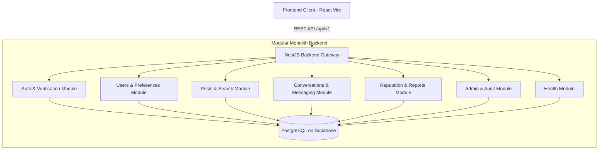

# Modular Monolith Architecture

## 1. Tổng quan

Hệ thống Campus Marketplace được thiết kế theo mô hình **Modular Monolith**:
- Triển khai thành một đơn vị chạy duy nhất (Single Deployable Unit) để đơn giản hóa vận hành, tránh chi phí và độ phức tạp của microservices, distributed transactions, Kafka, Kubernetes trong giai đoạn này.
- Phân chia mã nguồn nội bộ thành các Module độc lập cao (High Cohesion, Low Coupling) theo ranh giới nghiệp vụ (Bounded Contexts).

## 2. Kiến trúc 3 tầng (Layered Architecture) trong mỗi Module

Mỗi module tuân thủ cấu trúc 3 tầng nghiêm ngặt:

1. **Controller Layer:**
   - Tiếp nhận HTTP Request, áp dụng Validation Pipe (DTOs).
   - Kiểm tra Authentication / Authorization Guards (JWT, Role, Verification Status).
   - Chuyển tiếp dữ liệu sạch cho Service Layer.

2. **Service Layer:**
   - Đảm nhiệm toàn bộ Business Logic và Business Invariants.
   - Quản lý Database Transaction khi một thao tác nghiệp vụ ghi dữ liệu vào nhiều bảng.
   - Phát sinh Domain Events / Notifications khi cần thiết.

3. **Repository Layer:**
   - Tiếp cận theo hướng **SQL-first** sử dụng thư viện `pg` (Node-postgres Pool).
   - Không phụ thuộc vào ORM nặng nề; câu truy vấn SQL minh bạch, tối ưu, dễ kiểm soát index và explain plan.
   - Đóng gói logic truy vấn bảng và ánh xạ kết quả thô sang Entity / Domain Model.
