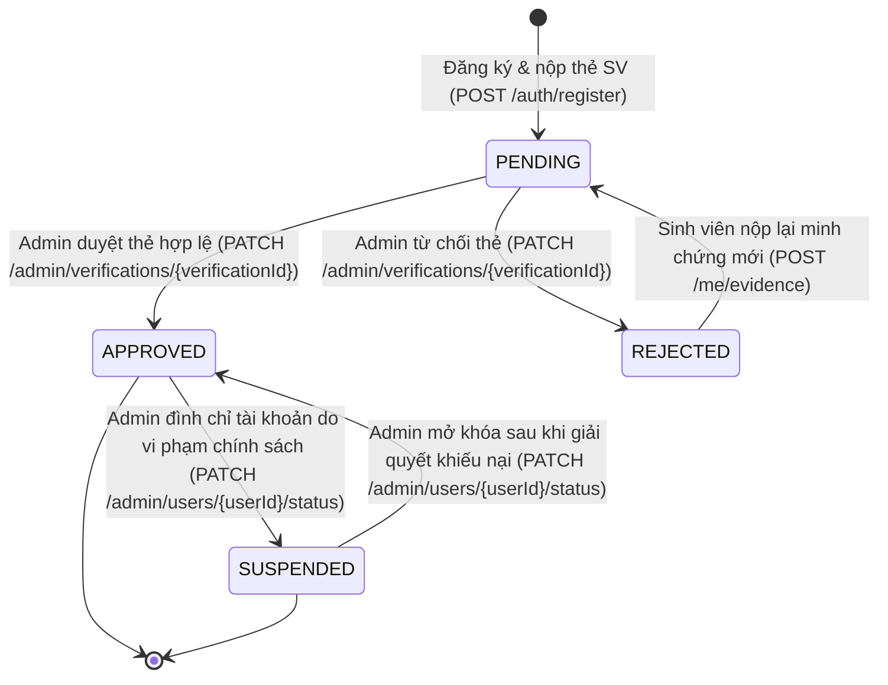
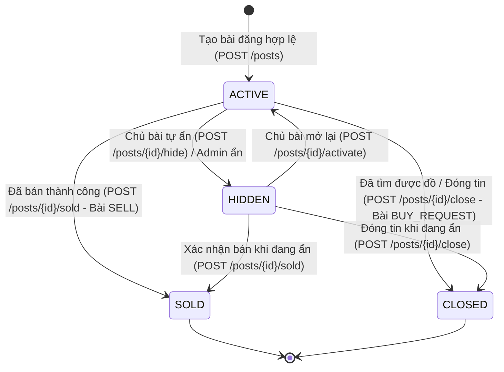
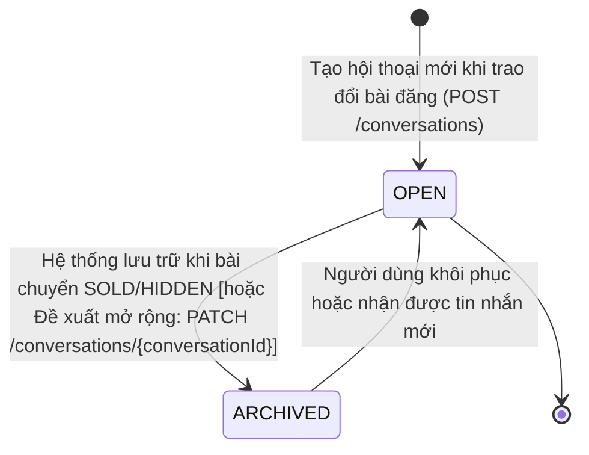
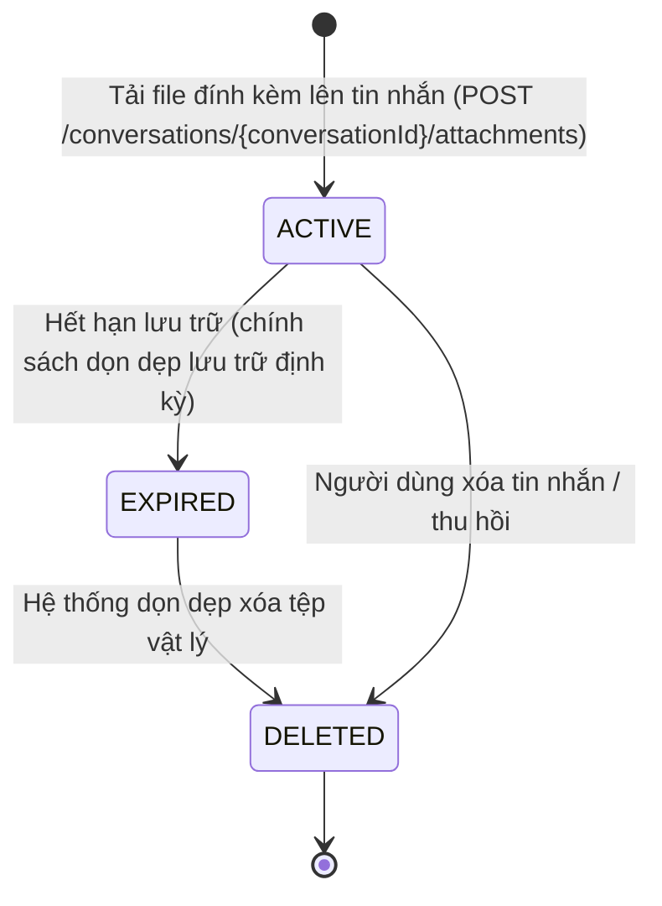

# State Machines - Campus Marketplace v1.2

Tài liệu này mô tả chi tiết các State Machine (máy trạng thái) cốt lõi của hệ thống Campus Marketplace, đảm bảo tính nhất quán 100% với:
- Database schema: [schema_v1.2.sql](../../database/baseline/schema_v1.2.sql)
- Nghiệp vụ: [Ho_so_nghiep_vu_Campus_Marketplace_v1.2.docx](../../docs/business-rules/README.md)
- API Contract: [openapi.yaml](../../packages/api-contract/openapi.yaml)

---

## 1. Verification Status State Machine (`verification_status`)

Quản lý vòng đời xác minh danh tính sinh viên của tài khoản người dùng (`users.verification_status`).

### Các trạng thái:
- `PENDING`: Tài khoản mới đăng ký qua email trường (`.edu.vn`), đã nộp ảnh thẻ sinh viên, đang chờ Admin duyệt.
- `APPROVED`: Admin đã xác minh thẻ sinh viên hợp lệ. Tài khoản có đầy đủ quyền đăng bài, chat, xem chi tiết bài đăng và tìm mua. Điểm uy tín khởi tạo mặc định là `5.0` (thang 0.0 - 5.0 theo `schema_v1.2.sql`).
- `REJECTED`: Admin từ chối thẻ sinh viên (ảnh mờ, sai thông tin, không chính chủ). Người dùng được phép upload lại thẻ mới (`POST /me/evidence`) để đưa về `PENDING`.
- `SUSPENDED`: Tài khoản bị tạm đình chỉ / khóa theo quyết định của Admin khi người dùng vi phạm nghiêm trọng chính sách hoặc có hành vi gian lận (được ghi nhận trong `audit_logs`). Hệ thống không tự động khóa theo ngưỡng điểm.

### Bảng chuyển trạng thái:
| Trạng thái hiện tại | Biến cố / Hành động | Tác nhân | Điều kiện / Ràng buộc | Trạng thái tiếp theo |
|---|---|---|---|---|
| `*` (Chưa có) | Đăng ký tài khoản | Khách vãng lai | Email `.edu.vn` hợp lệ, upload thẻ SV | `PENDING` |
| `PENDING` | Phê duyệt thẻ | Admin | Ảnh thẻ rõ nét, khớp MSSV và trường (`PATCH /admin/verifications/{verificationId}`) | `APPROVED` (khởi tạo uy tín 5.0 mặc định) |
| `PENDING` | Từ chối thẻ | Admin | Thẻ không hợp lệ kèm lý do (`PATCH /admin/verifications/{verificationId}`) | `REJECTED` |
| `REJECTED` | Nộp lại thẻ SV | Sinh viên | Upload minh chứng mới (`POST /me/evidence`) | `PENDING` |
| `APPROVED` | Đình chỉ tài khoản | Admin | Quyết định Admin khi vi phạm nghiêm trọng (`PATCH /admin/users/{userId}/status`) | `SUSPENDED` |
| `SUSPENDED` | Mở khóa tài khoản | Admin | Khiếu nại thành công (`PATCH /admin/users/{userId}/status`) | `APPROVED` |

---

## 2. Post Status State Machine (`post_status`)

Quản lý trạng thái bài đăng bán đồ cũ (`SELL`) và bài tìm mua (`BUY_REQUEST`).

### Các trạng thái:
- `ACTIVE`: Bài đăng đang hiển thị công khai trên bảng tin và kết quả tìm kiếm.
- `HIDDEN`: Bài đăng tạm ẩn (chủ bài đăng tự ẩn hoặc Hệ thống / Admin cưỡng chế ẩn do vi phạm/tố cáo).
- `SOLD`: Bài bán hàng đã giao dịch thành công (chỉ áp dụng bài `SELL`).
- `CLOSED`: Yêu cầu tìm mua đã hoàn tất hoặc đóng lại (áp dụng bài `BUY_REQUEST` hoặc chủ động đóng).

### Bảng chuyển trạng thái:
| Trạng thái hiện tại | Biến cố / Hành động | Tác nhân | Điều kiện / Ràng buộc | Trạng thái tiếp theo |
|---|---|---|---|---|
| `*` | Đăng bài | Chủ bài đăng (APPROVED) | Đúng danh mục, giá và hình ảnh (`POST /posts`) | `ACTIVE` |
| `ACTIVE` | Ẩn bài đăng | Chủ bài / Admin / Bot | Tự ẩn (`POST /posts/{id}/hide`) hoặc bị tố cáo quá hạn | `HIDDEN` |
| `HIDDEN` | Bật lại hiển thị | Chủ bài đăng | Chỉ khi bài tự ẩn (`POST /posts/{id}/activate`) | `ACTIVE` |
| `ACTIVE` / `HIDDEN` | Đánh dấu đã bán | Chủ bài đăng | Áp dụng bài `SELL` (`POST /posts/{id}/sold`) | `SOLD` |
| `ACTIVE` / `HIDDEN` | Đóng bài tìm mua | Chủ bài đăng | Áp dụng bài `BUY_REQUEST` (`POST /posts/{id}/close`) | `CLOSED` |

---

## 3. Report Status State Machine (`report_status`)

Được thiết kế chính xác theo PostgreSQL enum v1.2:
`CREATE TYPE "report_status" AS ENUM ('SUBMITTED', 'WAITING_SELLER_RESPONSE', 'UNDER_REVIEW', 'RESOLVED', 'DISMISSED', 'NO_RESPONSE');`

### Các trạng thái:
1. `SUBMITTED`: Tố cáo mới được người mua/người dùng gửi lên hệ thống (`POST /reports`).
2. `WAITING_SELLER_RESPONSE`: Áp dụng cho lý do `STALE_SOLD_POST` (hàng ảo, đã bán nhưng cố tình giữ bài để câu tương tác). Hệ thống tự động gửi cảnh báo và hẹn giờ 24h để người bán phản hồi qua `POST /reports/{reportId}/seller-response`.
3. `NO_RESPONSE`: Hết hạn 24h (`responseDeadlineAt`) mà người bán không phản hồi. Hệ thống tự động chuyển sang `NO_RESPONSE`, tăng bộ đếm `no_response_count`. Khi đạt chu kỳ ngưỡng K (K cấu hình từ 3 đến 5; mặc định K = 3), hệ thống trừ `-0.1` điểm uy tín (không thấp hơn 0.0) và ghi nhận vào bảng `reputation_events` (BR-15, BR-16).
4. `UNDER_REVIEW`: Admin đang trực tiếp thụ lý, điều tra và xác minh bằng chứng vi phạm.
5. `RESOLVED`: Admin đã xử lý xong và đưa ra quyết định xử phạt (`PATCH /admin/reports/{reportId}`: ẩn bài, trừ uy tín, tạm khóa).
6. `DISMISSED`: Admin bác bỏ báo cáo do sai sự thật, vu khống hoặc không đủ bằng chứng (`PATCH /admin/reports/{reportId}`).

```mermaid
stateDiagram-v2
    [*] --> SUBMITTED: Người dùng gửi tố cáo (POST /reports)
    
    SUBMITTED --> WAITING_SELLER_RESPONSE: Lý do STALE_SOLD_POST (Kích hoạt đếm ngược 24h)
    SUBMITTED --> UNDER_REVIEW: Các lý do khác (Gian lận, hàng cấm, thông tin sai lệch)
    
    WAITING_SELLER_RESPONSE --> UNDER_REVIEW: Người bán gửi phản hồi (POST /reports/{reportId}/seller-response)
    WAITING_SELLER_RESPONSE --> NO_RESPONSE: Hết hạn 24h không phản hồi (Tăng no_response_count; trừ 0.1 uy tín mỗi chu kỳ K)
    
    NO_RESPONSE --> UNDER_REVIEW: Người bán khiếu nại quyết định tự động
    NO_RESPONSE --> RESOLVED: Khép lại hồ sơ xử phạt tự động
    
    UNDER_REVIEW --> RESOLVED: Admin xác định có vi phạm (PATCH /admin/reports/{reportId})
    UNDER_REVIEW --> DISMISSED: Admin bác bỏ tố cáo (PATCH /admin/reports/{reportId})
    
    RESOLVED --> [*]
    DISMISSED --> [*]
```

### Bảng chuyển trạng thái Report:
| Trạng thái hiện tại | Biến cố | Tác nhân | Điều kiện | Trạng thái tiếp theo |
|---|---|---|---|---|
| `*` | Gửi tố cáo | Người dùng đã duyệt (`APPROVED`) | Báo cáo bài đăng của người khác (`POST /reports`) | `SUBMITTED` |
| `SUBMITTED` | Kích hoạt xác thực 24h | Hệ thống | `reason = STALE_SOLD_POST` | `WAITING_SELLER_RESPONSE` |
| `SUBMITTED` | Chuyển điều tra | Hệ thống / Admin | `reason != STALE_SOLD_POST` | `UNDER_REVIEW` |
| `WAITING_SELLER_RESPONSE` | Người bán giải trình | Người bán bị tố cáo | Trong thời hạn 24h (`POST /reports/{reportId}/seller-response`) | `UNDER_REVIEW` |
| `WAITING_SELLER_RESPONSE` | Hết hạn 24h | Hệ thống (Cron job) | Không nhận được phản hồi | `NO_RESPONSE` (Tăng `no_response_count`; trừ `-0.1` uy tín nếu đạt chu kỳ K theo BR-16) |
| `NO_RESPONSE` | Khiếu nại lại | Người bán | Cung cấp minh chứng bất khả kháng | `UNDER_REVIEW` |
| `NO_RESPONSE` | Đóng hồ sơ | Hệ thống | Quá hạn khiếu nại | `RESOLVED` |
| `UNDER_REVIEW` | Kết luận vi phạm | Admin | Bằng chứng xác đáng (`PATCH /admin/reports/{reportId}`) | `RESOLVED` (xử phạt tương ứng) |
| `UNDER_REVIEW` | Bác bỏ tố cáo | Admin | Tố cáo không có căn cứ (`PATCH /admin/reports/{reportId}`) | `DISMISSED` |

---

## 4. Conversation Status State Machine (`conversation_status`)

Quản lý trạng thái hộp thoại trò chuyện trực tiếp giữa người mua và người bán.

### Các trạng thái:
- `OPEN`: Cuộc trò chuyện đang mở, có thể gửi và nhận tin nhắn theo thời gian thực.
- `ARCHIVED`: Một hoặc hai bên đã đưa cuộc trò chuyện vào kho lưu trữ (ẩn khỏi danh sách hiển thị chính). Khi có tin nhắn mới, hội thoại tự động chuyển lại `OPEN`.

---

## 5. Attachment Status State Machine (`attachment_status`)

Quản lý tệp đính kèm trong tin nhắn chat (ảnh đồ họa, hình chụp sản phẩm).

### Các trạng thái:
- `ACTIVE`: Tệp đã upload lên Object Storage thành công và đang khả dụng.
- `EXPIRED`: Tệp đã quá thời hạn lưu trữ tạm thời (theo chính sách dọn dẹp dung lượng).
- `DELETED`: Tệp đã được xóa khỏi Object Storage và đánh dấu xóa trong CSDL.

---

## 6. Quy tắc Nghiệp vụ Điểm Uy tín & Đình chỉ Tài khoản (v1.2 Baseline)

Đối chiếu chính xác [Hồ sơ nghiệp vụ v1.2](../../docs/business-rules/README.md) và SQL Baseline [schema_v1.2.sql](../../database/baseline/schema_v1.2.sql):

1. **Thang điểm uy tín (`reputation_score`):**
   - Ràng buộc CSDL: `0.0 <= reputation_score <= 5.0` (Kiểu dữ liệu `numeric(2,1)`).
   - Giá trị khởi tạo mặc định: **`5.0`** (Không sử dụng thang điểm 100).
   - Tuyệt đối không có tính năng chấm sao thủ công hay review tự do giữa người dùng; điểm uy tín hoàn toàn do hệ thống quản lý khách quan.
2. **Quy tắc trừ điểm theo chu kỳ (BR-15, BR-16):**
   - Khi báo cáo người bán vi phạm hết hạn phản hồi 24h (`responseDeadlineAt`), trạng thái chuyển thành `NO_RESPONSE` và tăng bộ đếm `users.no_response_count`.
   - Mỗi khi bộ đếm đạt một chu kỳ ngưỡng $K$ (tham số cấu hình hệ thống từ 3 đến 5; giá trị mặc định là **$K = 3$**), hệ thống kích hoạt trừ đúng **`-0.1`** điểm uy tín (`delta = -0.10`).
   - Điểm uy tín sau khi trừ bị chặn dưới tại mức sàn **`0.0`**.
   - Bảng `reputation_events` lưu vết giao dịch: `seller_id`, `report_cycle_key` (duy nhất để chống trừ trùng chu kỳ), `delta`, `before_score`, `after_score`, `reason`, `created_at`.
3. **Đình chỉ tài khoản (`SUSPENDED`):**
   - Đình chỉ tài khoản là một quyết định hành chính có chủ đích của Quản trị viên (`ADMIN`), được thực hiện thông qua endpoint `PATCH /admin/users/{userId}/status`.
   - Mọi hành vi đình chỉ tài khoản phải có căn cứ rõ ràng (hành vi lừa đảo, tái phạm nhiều lần, vi phạm pháp luật) và bắt buộc phải lưu lý do kèm ghi nhật ký kiểm toán vào bảng `audit_logs` (BR-18).
   - **Không tồn tại cơ chế tự động khóa tài khoản khi điểm uy tín $\le 20$** trong Hồ sơ nghiệp vụ v1.2. Mọi thông tin trước đây nhắc tới ngưỡng 20 điểm hay khởi tạo 100 điểm đều là giả định sai lệch và đã được loại bỏ hoàn toàn.

